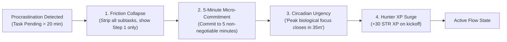

# Mindset Machine — Research, Competitive Analysis & Departmental Product Specification

## 1. Competitive Analysis & Market Positioning

To create an executive productivity cockpit that actively propels users into immediate action without visual clutter, we conducted comparative research across leading productivity, habit, and biometric platforms:

| Platform | Core Strength | Fatal Flaw | Mindset Machine Counter-Strategy |
|:---|:---|:---|:---|
| **Sunsama / Motion** | Daily time-boxing, calendar integration | Heavy sidebar clutter, overwhelming task backlogs causing decision fatigue | Dedicated **Assistant Department** with isolated AI routine optimizer + zero-scroll focus blocks |
| **Rise Science** | Sleep debt tracking & circadian energy window prediction | Zero task execution, habit tracking, or project management capabilities | **Biometric Telemetry Strip** auto-ingesting Google Fit & Health Connect to modulate cognitive load |
| **Fabulous / Loop** | Micro-habit rituals & onboarding sequences | Brittle streak counters cause despair and abandonment upon a single miss | **Rolling Consistency Scoring (0–100%)** across Morning, Afternoon, and Evening circadian windows |
| **Habitica / RPGs** | XP incentives, attribute stats, dynamic leveling | Cluttered 8-bit sprites that break executive immersion for serious professionals | **Hunter Awakening System**: sleek cybernetic tokens, $+30\text{ STR XP}$ rewards, Rank E $\rightarrow$ S progression |
| **WHOOP / Oura** | Best-in-class recovery, HRV, and sleep staging | Siloed hardware experience disconnected from daily task prioritization | **Wearable IoT Bridge** that maps resting heart rate directly into deep-work allocation |
| **Superhuman** | Instant keyboard shortcuts, ultra-fast workflow | Restricted to email workflows | **Apex Command Palette** (`Ctrl+K`) and 1-key instant departmental jumps (`1`–`9`) |

---

## 2. Multi-Method Motivation System ("Push-to-Work" Engine)

When psychological resistance or procrastination occurs, Mindset Machine deploys four evidence-based triggers in sequence:

1. **Friction Collapse:** Replaces monolithic planning with a single granular micro-action (e.g., "Open document and write one sentence").
2. **5-Minute Micro-Commitment Rule:** Eliminates dread by lowering the barrier to entry to 5 minutes of non-negotiable kickoff time.
3. **Circadian Urgency Matching:** Alerts the user to biological peak windows ("Cortisol window closing — lock in deep work now").
4. **Hunter XP Surge:** Immediate tactile gamification: $+30\text{ STR XP}$, audio chime, and haptic feedback.

---

## 3. Departmental Workflow Specifications

The system is partitioned into **9 autonomous functional departments**, each engineered for a single focused outcome without cluttering the main interface:

### 3.1 Cockpit Department (`src/components/dashboard/`)
- **Primary Goal:** Executive status snapshot and live biometric vital signs in $< 3$ seconds.
- **Workflow Flow:**
  1. User launches app $\rightarrow$ native bridge connects to Google Fit / Health Connect automatically.
  2. Velocity Arc renders recovery readiness ($0-100\%$) and daily cognitive load balance.
  3. Hunter Directives display current Rank (E $\rightarrow$ S), level progress, and attribute stats (STR, INT, AGI, VIT).
  4. Execution Queue card surfaces the highest-priority flame task.
  5. User presses `c` or clicks the input strip to append a task directly.

### 3.2 Tasks Department (`src/components/tasks/`)
- **Primary Goal:** High-velocity neuro-cognitive execution without backlog overwhelm.
- **Workflow Flow:**
  1. Priority flame toggle (`high` / `med` / `low`) and cognitive context (`deep` / `flow` / `admin`).
  2. "Rule of 3" daily focus: highlights 3 non-negotiable wins for today.
  3. Instant complete with tactile haptic tick $\rightarrow$ task moves to completed log with $+30\text{ XP}$.
  4. Accidental completion can be reversed via `Ctrl+Z` (Undo Toast).

### 3.3 Habits Department (`src/components/habits/`)
- **Primary Goal:** Circadian behavioral consistency without streak despair.
- **Workflow Flow:**
  1. Habits categorized by biological windows: Morning (Sunlight/Hydration), Afternoon (Deep Work/Movement), Evening (Shutdown/Sleep Prep).
  2. Rolling percentage consistency score calculated per period ($0-100\%$) rather than rigid binary streaks.
  3. Check off habit $\rightarrow$ updates period consistency gauge and triggers vitality XP.

### 3.4 Timetable Department (`src/components/timetable/`)
- **Primary Goal:** Chronological focus blocks with zero calendar clutter.
- **Workflow Flow:**
  1. Chronological time-block horizon showing active block vs. upcoming blocks.
  2. **Active Focus Hero Card:** Live real-time countdown timer for the ongoing session.
  3. Quick-block creation with category presets: Deep Work, Health/Vitality, Strategic Planning, Rest.

### 3.5 Horizons Department (`src/components/goals/`)
- **Primary Goal:** Three-tier strategic alignment (North Stars $\rightarrow$ Keystones $\rightarrow$ Monthly Targets).
- **Workflow Flow:**
  1. Monumental long-term goals filtered by temporal horizon.
  2. Progress bars track completed initiatives against total directives.
  3. Bi-directional link between daily tasks and long-term milestones.

### 3.6 Activity Department (`src/components/activity/`)
- **Primary Goal:** Metacognitive telemetry ledger and historical habit heatmaps.
- **Workflow Flow:**
  1. 14-day execution density heatmap showing high-focus vs. low-focus days.
  2. Filterable audit ledger (All, Tasks, Habits, Goals).
  3. **Evening Audit Modal:** Prompts user at day's end to record 3 wins, identify friction blockers, and prime tomorrow's priority.

### 3.7 Assistant Department (`src/components/assistant/`)
- **Primary Goal:** Proactive AI routine optimization and calendar synchronization.
- **Workflow Flow:**
  1. Ingests current recovery score and pending tasks.
  2. Generates optimized daily time-blocks (e.g., deep work during high HRV mornings).
  3. Exports calendar to `.ics` format or syncs to external providers.

### 3.8 Notes Department (`src/components/notes/`)
- **Primary Goal:** Zero-friction scratchpad converting raw thoughts into actionable tasks.
- **Workflow Flow:**
  1. Quick markdown input strip with tag filtering.
  2. Pinned notes stay at the top of the stream.
  3. One-click conversion: transforms any note into a high-priority task.

### 3.9 Vault Department (`src/components/vault/`)
- **Primary Goal:** Total data sovereignty, offline backup, and external integration.
- **Workflow Flow:**
  1. Local storage metrics and KPI breakdown.
  2. One-click JSON export and import for seamless multi-device transfers.
  3. Markdown export formatted specifically for Obsidian and Notion knowledge bases.

---

## 4. Clutter-Free UI Transitions & Departmental Isolation

To prevent visual fatigue:
- **One Focus at a Time:** Department navigation strictly swaps the active view. Content from inactive departments is unmounted from the DOM, keeping memory footprint low.
- **180ms GPU Cross-Fade:** Department transitions use `opacity` and `translateY(4px)` with zero sliding motion or layout shifts.
- **Micro-Affordances:** Interactive elements use subtle luminance shifts on hover/press rather than intrusive modal interruptions.
